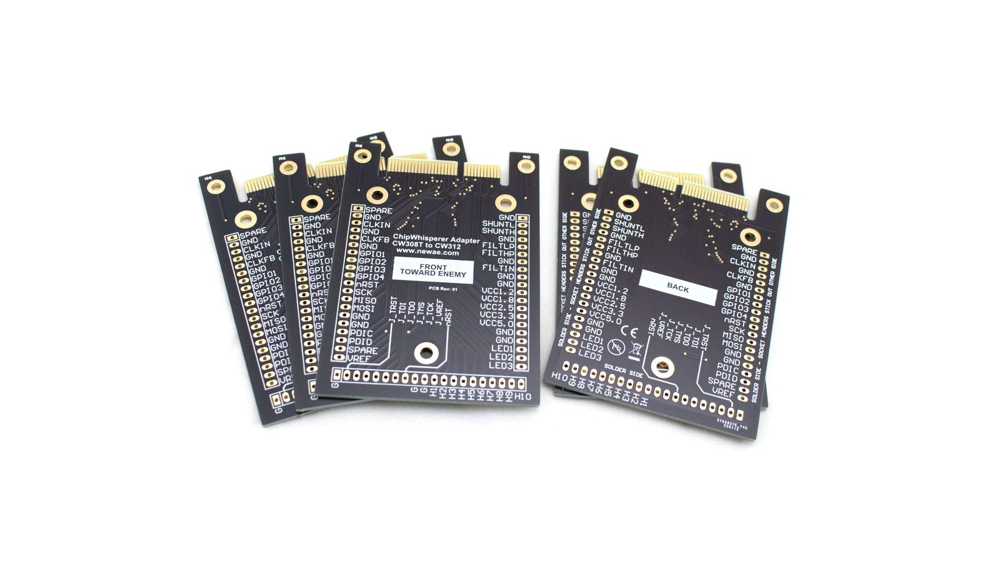

# CW308 to CW312 Adapter / Breakout board

This adapter allows soldering of a CW308-style target onto the adapter,
which can then be inserted into a CW312-style baseboard (which uses the edge
connector), such as the [CW313](CW313.md) Optionally, you can solder 20-pin
sockets (not included) to make a general- purpose adapter. Suggested to use
part number Preci-Dip 801-87-020-10-001101 for this purpose (this is same
header used on the CW308).

## Datasheet and Schematic

[CW308 to CW312 Adapter datasheet](https://media.newae.com/datasheets/NAE-CW312TADPT_datasheet.pdf)

